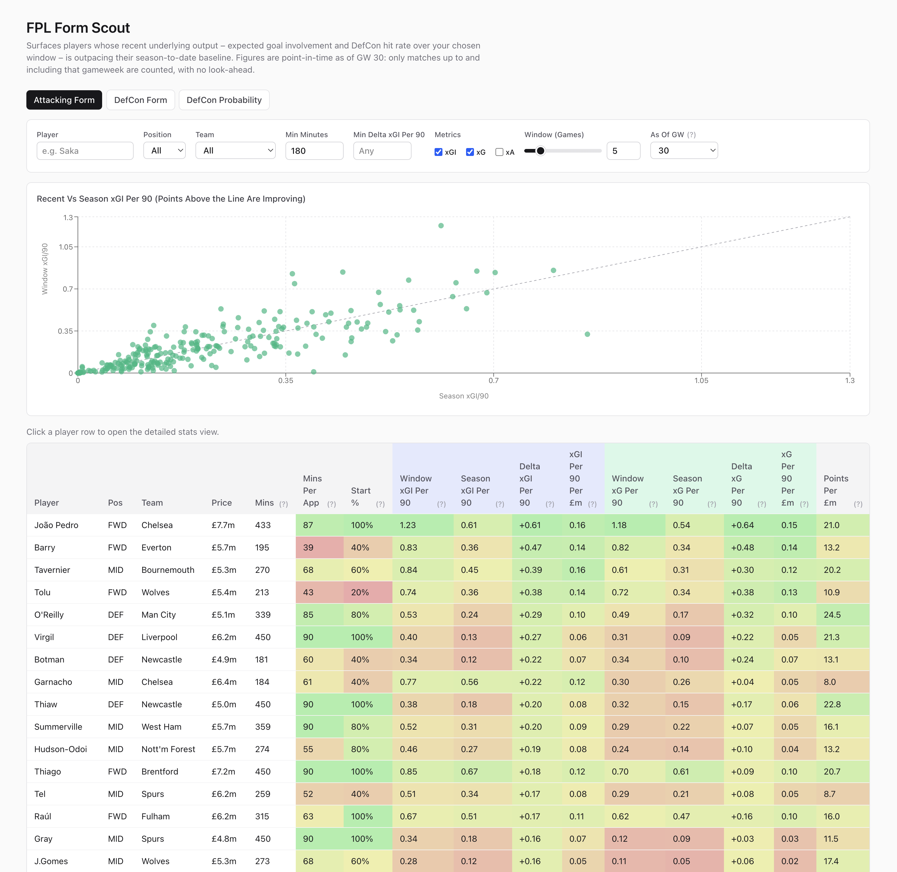
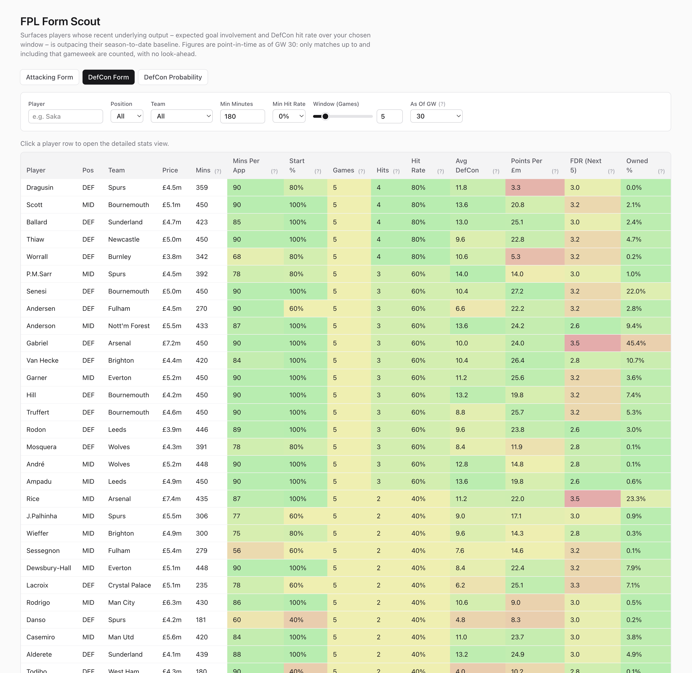
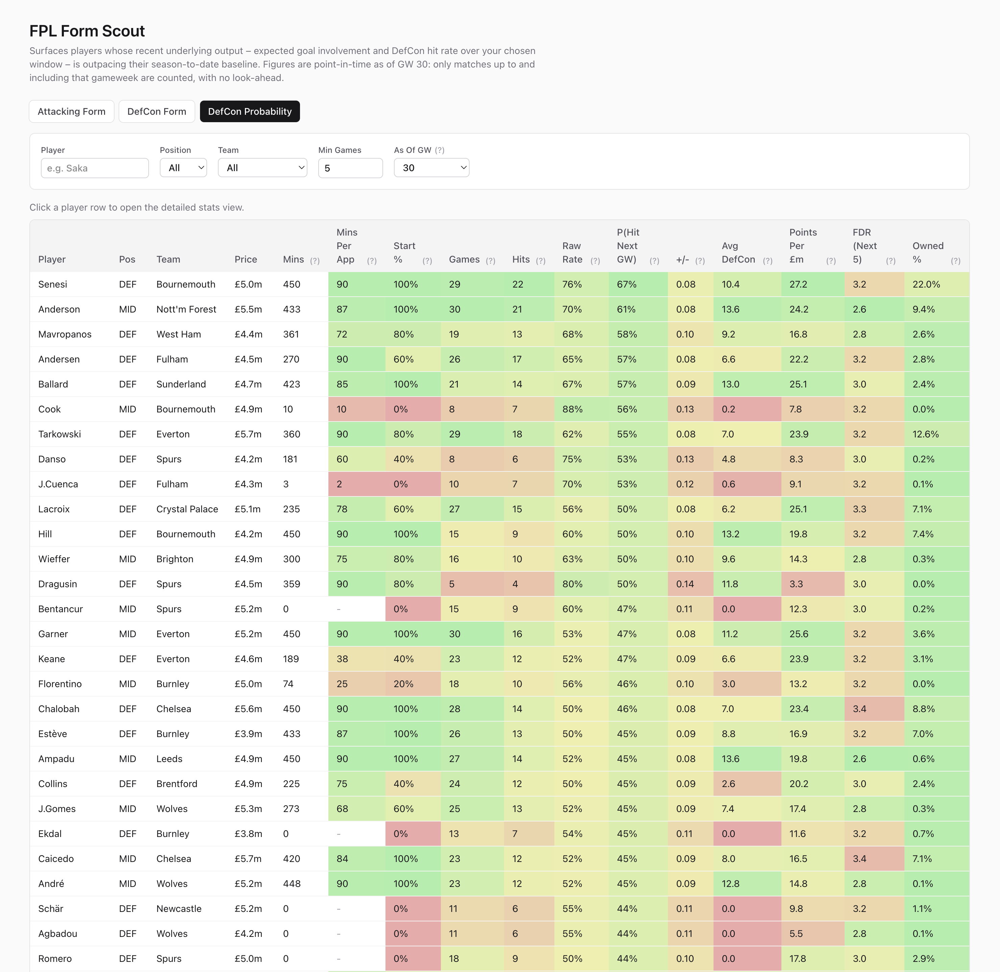
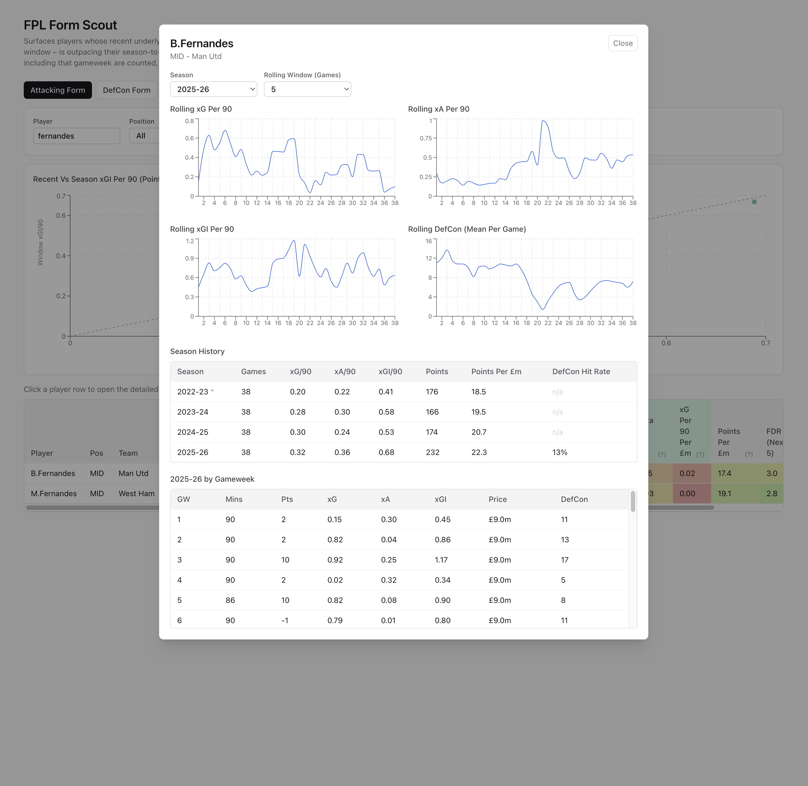
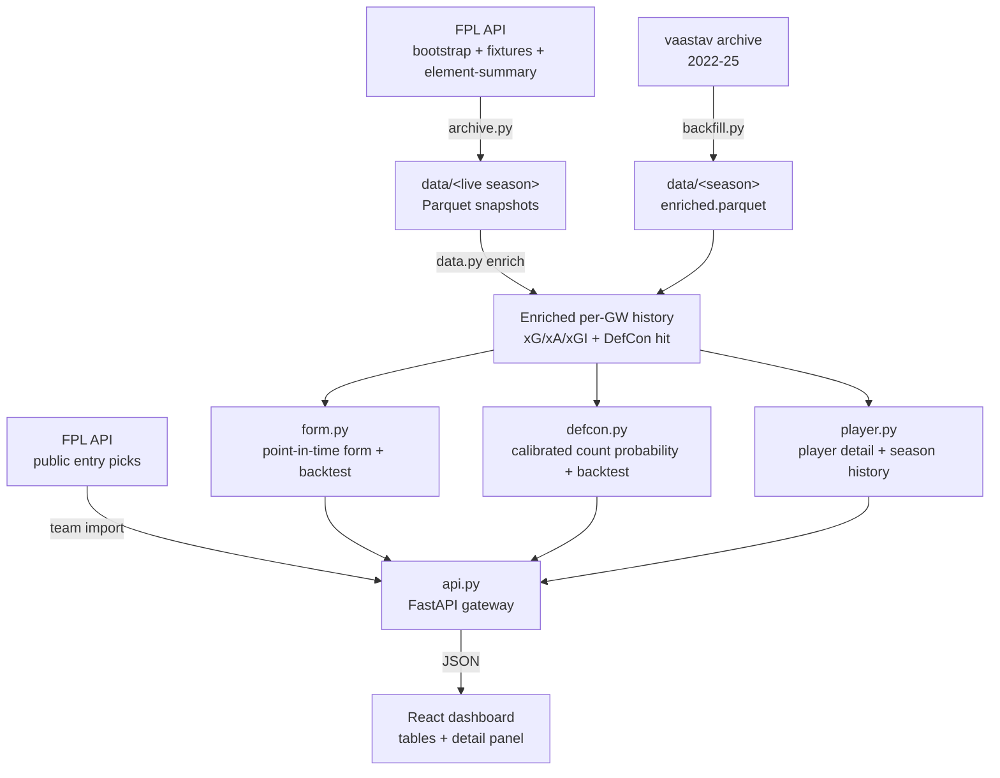

# FPL Analytics Engine

[](https://github.com/astral-sh/ruff)
[](https://github.com/IsaacCheng9/fpl-analytics-engine/actions/workflows/test.yml)
[](https://github.com/IsaacCheng9/fpl-analytics-engine/actions/workflows/frontend.yml)

A Fantasy Premier League analytics engine that surfaces players whose recent
underlying output has pulled away from their season baseline, and estimates how
likely each player is to earn a defensive-contribution point. Every metric is
strictly point-in-time – as of any gameweek, only data from that gameweek and
earlier is used – so the engine is fully back-testable with no look-ahead.

The differentiator over public form tables is the combination of a configurable
recent-form window, expected-stats (xG/xA/xGI) rather than raw points, transfer
candidate context, and a point-in-time design that lets every recommendation be
replayed and scored against what actually happened next. The dashboard can also
import a public FPL squad, so the same evidence can be read through a transfer
planning lens: which players you own, which candidates are shortlisted, and
where the current squad looks weak for the next gameweek.

## Key Features

- **Point-in-time form engine** – ranks players by the swing between their
  recent N-gameweek per-90 expected output (xG/xA/xGI) and their season-to-date
  baseline, so a player heating up shows a positive `delta_xgi90` before the raw
  points catch up
- **DefCon hit-probability model** – a calibrated contribution-count model that
  estimates `P(Hit | 60+ Mins)`, uses the size of each
  defensive-contribution performance, then recalibrates those probabilities
  against prior point-in-time prediction buckets
- **Backtesting harness** – replays each gameweek on the point-in-time view,
  flags players, then scores the flags against the following gameweeks, with
  Brier score and a calibration table for the probability model
- **Model evidence view** – surfaces the DefCon probability backtest and the
  corrected club-form validation inside the dashboard, including negative
  results where recent form did not beat a season-to-date baseline
- **Season archival** – snapshots preseason players and fixtures as soon as the
  FPL game rolls over, then adds current-season per-gameweek detail after GW1
- **Historical backfill** – adapts the vaastav community archive (2022-23
  onward) into the same enriched schema, so the form engine runs across seasons
  for cross-season comparison
- **One-command data refresh** – archives the latest live season, refreshes the
  cross-season enriched snapshots, validates the Parquet data, and runs the
  real-data smoke check before refreshed snapshots are pushed
- **REST API** – a FastAPI gateway exposing the form, DefCon,
  DefCon-probability, FPL team import, model-evidence, club-form, and
  player-detail views
- **Interactive web dashboard** – a React single-page app with sortable,
  filterable tables across Attacking Form, DefCon Form, DefCon Probability, Club
  Form, and Model Evidence views, URL-backed controls, active filter chips,
  presets, heat-shaded metrics, sticky player context columns, and a collapsible
  form-versus-baseline scatter plot in Attacking Form
- **Transfer decision workflow** – combines attacking-threat thresholds, price,
  FDR, minutes, starts, ownership, shortlist filtering, and side-by-side player
  comparison so transfer candidates can be narrowed and inspected without
  leaving the table context
- **Team-aware squad inspection** – imports a public FPL team ID, highlights
  currently owned players, filters owned/not-owned players, and shows a
  next-gameweek squad inspection view with next fixture, FDR, minutes, threat,
  `P(Hit | 60+ Mins)`, ownership, and transparent risk/hold flags
- **Player detail view** – click any table row to inspect a player's
  selected-season gameweeks, rolling xG/xA/xGI per 90, rolling DefCon counts,
  and cross-season history keyed by stable FPL `code`
- **Club form context** – compares each club's recent attacking and defensive
  output with its season baseline, then shows that form next to upcoming FDR

## Screenshots

### Attacking Form



### DefCon Form



### DefCon Probability



### Detailed Player View



## Methodology

### Form

For a chosen as-of gameweek, each player gets two per-90 expected-output figures
– one over the last `window` gameweeks, one over the season to date – computed
from minutes-weighted xG, xA, and xGI. The headline signal is
`delta_xgi90 = window_xgi90 - season_xgi90`: how far a player's recent
underlying involvement has risen above their own baseline. Both figures use only
games up to and including the as-of gameweek, so the table is exactly what was
knowable at that point in the season. The dashboard exposes xGI, xG, and xA as
separate metric groups, with window, season, delta, and per-price views for each
enabled metric.

### Transfer Workflow

The dashboard is designed around narrowing transfer candidates without hiding
the underlying evidence. Transfer filters apply across the player tables: price
ceiling, FDR ceiling, minutes floor, minutes per appearance, start percentage,
ownership range, and minimum attacking-threat thresholds for the enabled
expected-stat metrics. Presets provide quick starting points for common
candidate types, while active filter chips make the current constraints visible
and removable.

Shortlisting is URL-backed, so a focused candidate list can be shared or
reopened, and the compare panel shows two selected players side by side using
the same point-in-time window and as-of gameweek assumptions. A public FPL team
ID can also be imported from the official entry-picks endpoint. Imported
ownership is labelled as `Currently Owned` because the app does not have
historical squad state; the analytics around those players still use the chosen
point-in-time `as_of_gw`.

The player table can switch between all players, the imported squad inspection,
and shortlisted players. The squad inspection view is diagnostic rather than a
solver: it shows the current squad as one list, with the current next fixture
and FDR, recent and season threat, minutes, start rate, `P(Hit | 60+ Mins)`,
ownership, and simple flags such as `Minutes Risk`, `Fixture Risk`,
`Low Threat`, `Rising Threat`, `DefCon Upside`, and `Good Hold`.

### Defensive Contribution (DefCon)

DefCon awards 2 FPL points when a player clears a positional threshold of
defensive actions in a match – defenders need 10+ CBIT (clearances, blocks,
interceptions, tackles); midfielders and forwards need 12+ CBIRT (CBIT plus
recoveries). Rather than report a raw hit-rate, the engine models each player's
probability of hitting from their defensive-contribution counts, conditional on
playing at least 60 minutes: a
Gamma-Poisson count model estimates the chance of clearing the positional
threshold, then a point-in-time calibration layer shrinks that probability
toward the observed hit-rate of similar prior predictions. The model is
evaluated by backtest. Brier score measures average probability error, so lower
is better: confident wrong predictions are punished more than cautious ones.
Expected calibration error (ECE) checks whether probabilities mean what they say
– for example, whether players predicted around 40% actually hit around 40% of
the time. The UI also surfaces average defensive-contribution counts, which show
whether a player is trending near the threshold even when their binary hit-rate
is flat.

#### DefCon Probability Backtest Results (2025-26 Season)

Every method was replayed point-in-time, predicting the following gameweek from
only data that would have been known at the as-of gameweek.

| Method | Brier | ECE | Verdict |
| --- | ---: | ---: | --- |
| Calibrated count model | 0.1387 | 0.0067 | Best displayed probability – keeps the count signal while making the probabilities trustworthy |
| Raw count model | 0.1385 | 0.0323 | Sharpest Brier, but overconfident; useful signal, misleading as a displayed probability |
| Binary empirical-Bayes model | 0.1406 | 0.0130 | Well-calibrated and safe, but throws away margin information from the contribution count |
| Raw player hit-rate | 0.1510 | 0.0632 | Too noisy and overconfident for small samples |
| Constant base rate | 0.1629 | 0.0000 | Perfectly calibrated by construction, but not useful for ranking players |

The calibrated count model is preferred because it keeps almost all of the raw
count model's Brier improvement while sharply reducing ECE, making the displayed
probability more trustworthy.

### Club Form

The club form view aggregates player histories into team-level attacking and
defensive form. Team xG is summed from player xG, while each club's xGC is the
opposing club's summed xG in the same fixture. Historical club identity comes
from the fixture rather than the player's final bootstrap metadata, so players
who transfer mid-season remain attributed to the club they represented in each
match. The view compares recent per-match xG and xGC against each club's
season-to-date baseline, then joins exact next-fixture context and the
next-five-gameweek FDR. Actual goals and goals conceded are available as
optional context, but expected data stays the default signal because finishing
and concession outcomes are noisier.

#### Validation Backtest Results (2025-26 Season)

The corrected validation compares a point-in-time season-to-date baseline with
that baseline plus recent club form. Every expanding training fold is purged so
that a row is eligible only when its complete future target horizon has ended by
the test as-of gameweek. Historical FDR is excluded: the archive contains only
the end-of-season fixture snapshot, so earlier FDR revisions cannot be
reproduced honestly.

On 460 corrected 2025-26 predictions per target, adding recent attacking form
made future xG prediction worse by 2.8% MAE and 5.5% RMSE. Adding recent
defensive form made future xGC prediction worse by 0.1% MAE and 1.2% RMSE.
These are negative results: club form remains useful descriptive context, but
this backtest does not support treating it as a predictive uplift. FDR remains
available in the live scouting view only as current fixture context.

### Data Availability Caveats

- Expected stats (xG/xA/xGI/xGC) exist from 2022-23 onward, so the form engine
  only runs from that season
- DefCon was introduced by FPL in 2025-26 – the underlying defensive components
  do not exist in any comparable form before then, so DefCon analysis is
  2025-26-only and historical seasons carry null DefCon columns
- In the vaastav archive, 2022-23 expected stats only cover GW16-38; scope
  2022-23 form comparisons to GW16 onward
- Cross-season player matching uses stable FPL `code`; historical `element` ids
  are season-local and are not safe for matching the same player across seasons
- Current ownership and imported squad membership are live/current-state
  overlays from the official FPL API; they are not point-in-time historical
  fields and do not change with `as_of_gw`
- Curated Parquet snapshots under `data/` are committed for reproducible
  deployment and personal/non-commercial use; they are sourced from the public
  FPL API and public community archives

## Architecture



## Technology Stack

### Backend

- **Python 3.14**: managed with uv
- **Polars**: all data loading, enrichment, and analytics
- **FastAPI**: REST gateway exposing the analytics views
- **Pydantic**: response modelling and validation
- **Ruff** and **Pyrefly**: linting, formatting, and type checking

### Frontend

- **React 19** with **TypeScript** on **Vite**: single-page dashboard
- **TanStack Table** and **TanStack Query**: sortable tables and data fetching
- **Recharts**: the form-versus-baseline scatter plot and player-detail rolling
  charts
- **Tailwind CSS**: styling
- **Biome**: linting and formatting
- **Vitest** with **Testing Library**: component tests

## Data

The engine reads from committed Parquet snapshots under `data/`:

- **Live archive** – `archive.py` snapshots the current season from the FPL API
  (`bootstrap-static` and per-player `element-summary`) before the API rolls
  over each July and the per-gameweek history is wiped. Before GW1, it archives
  players, teams, events and fixtures without making hundreds of empty
  `element-summary` requests
- **Historical backfill** – `backfill.py` pulls the
  [vaastav archive](https://github.com/vaastav/Fantasy-Premier-League) for
  2022-23 to 2024-25 and maps it into the same enriched schema, so the same form
  functions work across every archived season. It also reads each season's
  `players_raw.csv` so historical `element` ids can be mapped to stable FPL
  `code` and current-style `web_name`

## Usage

### Installing Dependencies

Run from the project root:

```bash
uv sync --all-extras --dev
```

### Refreshing Data

Refresh the committed Parquet snapshots with one command:

```bash
uv run python -m fpl_analytics_engine.refresh
```

The refresh command archives the current live FPL season into the detected
`data/<season>/` folder, backfills historical seasons from the vaastav archive,
canonicalises the current season's `enriched.parquet`, runs data-health
validation, and finishes with the real-data smoke check. Use it before pushing
updated `data/` snapshots during the season.

Only gameweeks marked both finished and data-checked by FPL are added to player
history. This makes a refresh safe during an active gameweek: zero-minute
placeholder rows and provisional results from that gameweek are excluded.

During preseason, the refresh deliberately writes no `enriched.parquet` because
there are no current-season performances to analyse. The API reports
`data_status: "preseason"` and the dashboard shows the next deadline instead of
serving the previous season as current data. Run the command again after GW1 is
complete to enable the current-season analytical views.

For a validation-only check of existing local snapshots:

```bash
uv run python -m fpl_analytics_engine.refresh --skip-archive --skip-backfill
```

### Archiving the Current Season

Snapshot the live FPL season to its detected `data/<season>/` folder:

```bash
uv run python -m fpl_analytics_engine.archive
```

### Backfilling Historical Seasons

Download and adapt the vaastav archive into `data/<season>/enriched.parquet`:

```bash
uv run python -m fpl_analytics_engine.backfill
```

The committed snapshots make the dashboard usable immediately after checkout;
the refresh command above is the preferred way to update them.

### Validating Local Data

Check that the committed Parquet snapshots are present and internally usable:

```bash
uv run python -m fpl_analytics_engine.data_health
```

Run the opt-in real-data smoke check after archiving and backfilling:

```bash
uv run python scripts/real_data_smoke.py
```

The smoke script uses Saka by default as a known cross-season player, verifies
stable-code matching, and checks that 2022-23 expected-stat rates are scoped to
GW16 onward.

Run the opt-in club-form validation against the current-season archive:

```bash
uv run python scripts/club_form_validation.py
```

### Running the API

```bash
uv run uvicorn fpl_analytics_engine.api:app --reload
```

- **API**: [http://localhost:8000](http://localhost:8000)
- **Interactive docs**: [http://localhost:8000/docs](http://localhost:8000/docs)

### Running the Dashboard

The frontend lives in [frontend/](./frontend) and expects the API running on
port 8000:

```bash
cd frontend
bun install
bun run dev
```

The dashboard is then served at [http://localhost:5173](http://localhost:5173).

### Deploying To Vercel

The repository includes a Vercel configuration for a single-project deployment:

- `frontend/` builds the static React dashboard
- `src/fpl_analytics_engine/vercel.py` exposes the FastAPI app as a Python ASGI
  function mounted under `/api` and serves the built Vite app for all non-API
  paths
- `vercel.json` builds the frontend and sets `PYTHONPATH=src` so Vercel's
  Python runtime can import the packaged app from the `src/` layout
- `data/` is committed so the deployed API can read the same Parquet snapshots
  as local development

In Vercel, import the repository with the project root set to the repository
root. The checked-in `vercel.json` builds the frontend, then
`src/fpl_analytics_engine/vercel.py` serves both the API and the single-page app
from one FastAPI deployment.

## API Endpoints

| Endpoint | Description | Parameters |
| --- | --- | --- |
| `GET /` | Live season, analytical readiness, next deadline, and latest completed gameweek | – |
| `GET /fpl-team/{entry_id}` | Import a public FPL entry's currently visible squad | Path: `entry_id`; query: `event` |
| `GET /players/form` | Players ranked by recent-versus-season xGI90 swing | `window`, `position`, `min_minutes`, `min_delta`, `top_k`, `as_of_gw`, `fdr_horizon` |
| `GET /players/defcon` | Players ranked by point-in-time DefCon hit-rate | `window`, `position`, `min_minutes`, `min_hit_rate`, `top_k`, `as_of_gw`, `fdr_horizon` |
| `GET /players/defcon-probability` | Players ranked by calibrated `P(Hit \| 60+ Mins)` | `position`, `min_games`, `min_minutes`, `top_k`, `as_of_gw`, `fdr_horizon` |
| `GET /players/defcon-probability-validation` | Backtest the DefCon probability model | `bins`, `min_minutes` |
| `GET /clubs/form` | Clubs ranked by recent-versus-season xG and xGC form | `window`, `top_k`, `as_of_gw`, `fdr_horizon` |
| `GET /clubs/form-validation` | Backtest a season baseline versus baseline plus recent club form | `window`, `horizon`, `min_train_rows` |
| `GET /players/{element}` | Point-in-time player gameweeks and cross-season summaries | Path: `element`; query: `window`, `season`, `as_of_gw` |

The analytical table endpoints accept `as_of_gw` to evaluate the point-in-time
view as it would have looked after an earlier gameweek; it defaults to the
latest gameweek in the data. Current ownership and `/fpl-team/{entry_id}` squad
membership are deliberately not point-in-time, because the FPL API exposes only
live ownership and visible entry-pick snapshots. The player-detail endpoint is
keyed by the current-season `element` id, tracks the player across seasons by
stable `code`, and uses `season` only to choose which season's gameweeks to
display.

Before GW1, analytical and team-import endpoints return HTTP 409 rather than
silently serving the previous season. In the deployed app, prefix these routes
with `/api` (for example, `/api/players/form`).

## Testing

Run the backend test suite with coverage:

```bash
uv run pytest -v --cov=src/fpl_analytics_engine --cov-report=term-missing
```

Run the frontend tests:

```bash
cd frontend
bun run test
```

Both suites run on every push via GitHub Actions.
