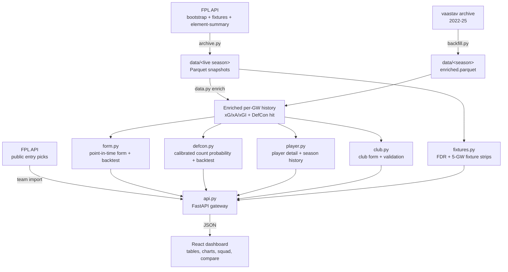

# FPL Analytics Engine

[](https://github.com/astral-sh/ruff)
[](https://github.com/IsaacCheng9/fpl-analytics-engine/actions/workflows/type-check.yml)
[](https://github.com/IsaacCheng9/fpl-analytics-engine/actions/workflows/test.yml)
[](https://github.com/IsaacCheng9/fpl-analytics-engine/actions/workflows/frontend.yml)

**Live dashboard:** [fpl-analytics-engine.vercel.app](https://fpl-analytics-engine.vercel.app)

A Fantasy Premier League analytics engine that ranks players by projected
expected goal involvement per gameweek, and estimates how likely each player is
to earn a defensive-contribution point. Every metric is strictly point-in-time –
as of any gameweek, only data from that gameweek and earlier is used – so the
engine is fully back-testable with no look-ahead.

The differentiator over public form tables is the combination of a configurable
recent-form window, expected stats (`xG`/`xA`/`xGI`) rather than raw points,
live transfer and fixture context, and a point-in-time design that lets every
recommendation be replayed and scored against what actually happened next.
The dashboard can also import a public FPL squad, splitting Starting XI from
Bench so you can see where your squad looks weak and jump straight to
filtered replacement candidates.

## Key Features

- **Point-in-time form engine** – ranks players by projected xGI per gameweek:
  an estimated underlying xGI per 90, pulled towards last season's rate, times
  expected minutes. Recent N-gameweek per-90 expected output (`xG`/`xA`/`xGI`)
  and its swing against the season-to-date baseline stay visible as descriptive
  context, because backtests found the swing does not persist
- **DefCon hit-probability model** – a calibrated contribution-count model that
  estimates `P(Hit | 60+ Mins)`, uses the size of each defensive-contribution
  performance, then recalibrates those probabilities against prior point-in-time
  prediction buckets
- **Backtesting harness and Research view** – replays each gameweek on the
  point-in-time view, then scores the form ranking signals, DefCon probabilities
  and club form against the following gameweeks inside the dashboard, including
  negative results where recent form did not beat a season-to-date baseline.
  Shows the last complete season until the live season reaches GW19, with a
  season selector for any season from 2025-26 onward
- **Interactive web dashboard** – a React single-page app with sortable,
  paginated tables (10, 25, 50, 100, or all rows; sorting and filtering apply to
  the full result set) across Attacking Form, DefCon Form, DefCon Probability,
  Club Form, and Research views, URL-backed controls, active filter chips,
  presets, colour-coded signal columns, sticky player context, and a
  Light / System / Dark theme toggle
- **Interactive screening scatter plot** – collapsible Attacking Form chart with
  three views (`Projected xGI vs Price` value frontier by default,
  `Est. xGI/90 vs Projected Minutes`, and `Recent vs Season xGI/90`),
  colour-coded by position or Squad / Shortlist, retaining all filtered players
  with click-through to Player Detail
- **Transfer workflow and live context** – filters by price, FDR, minutes,
  starts, ownership, attacking-threat thresholds, shortlist, `Exclude
  Unavailable`, and `Penalties Only`, with live-snapshot availability,
  yellow-card suspension watch, and set-piece badges (`P`, `C`, `FK`) across
  all player views
- **Actionable squad inspection** – imports a public FPL team ID, splits
  Starting XI from Bench in FPL auto-sub order, displays a summary bar with
  optional Bank (£m) input and 5-GW colour-coded fixture strips, flags
  availability, card risk, minutes, fixture, threat, and DefCon upside, and
  provides one-click `Replace` filtering into Attacking Form
- **Player detail and side-by-side comparison** – click any player row to
  inspect live availability, news, set-piece duties, yellow cards, a 5-GW
  fixture strip, rolling `xG`/`xA`/`xGI` per 90 and DefCon charts, per-gameweek
  opponent, venue, goals, assists, and bonus, and cross-season history keyed by
  stable FPL `code`. Compare two players side by side with overlaid rolling
  `xGI/90` and DefCon charts, a `Swap` control, fixture strips, and live
  snapshot context
- **Club form context** – compares each club's recent attacking and defensive
  expected output with its season baseline alongside a colour-coded `Next 5`
  fixture strip and 5-GW FDR
- **Automated data pipeline and REST API** – archives live FPL snapshots
  (including preseason rollover handling), backfills 2022-25 from the vaastav
  community archive into the same enriched schema, publishes atomically after
  data-health validation and real-data smoke checks, and serves all views over
  a FastAPI gateway

## Screenshots


<details>
<summary>DefCon Form</summary>


</details>

<details>
<summary>DefCon Probability</summary>


</details>

<details>
<summary>Club Form</summary>


</details>

<details>
<summary>Research</summary>


</details>

<details>
<summary>Detailed Player View</summary>


</details>

<details>
<summary>Compare Players</summary>


</details>

<details>
<summary>Dark Mode</summary>


</details>

## Methodology

### Form

For a chosen as-of gameweek, each player gets per-90 expected-output figures
over the last `window` gameweeks and over the season to date, computed from
minutes-weighted xG, xA, and xGI. All figures use only games up to and including
the as-of gameweek, so the table is exactly what was knowable at that point in
the season.

The table ranks players by `projected_xgi`, their expected xGI per gameweek:

- `est_xgi90` – the season-to-date rate pulled towards last season's rate, which
  counts as 900 extra minutes for players with 900+ expected-stat minutes last
  season
  - Last season dominates early on and fades as this season's minutes
    accumulate; players without enough minutes last season keep their
    season-to-date rate
- `projected_minutes` – an even blend of recent-window and season-to-date
  minutes per gameweek, because recent playing-time changes partly persist
  - Both count only gameweeks since the player joined the game, so a
    mid-season signing is not diluted by gameweeks before their arrival
- `projected_xgi = est_xgi90 * projected_minutes / 90`

The recent swing, `delta_xgi90 = window_xgi90 - season_xgi90`, is still shown
but is descriptive only (see the backtest results below). The dashboard exposes
xGI, xG, and xA as separate metric groups, with estimated, window, season,
delta, and per-price views for each enabled metric.

Form backtests use complete, finalised single-season history and score only
as-of gameweeks whose later gameweeks have all been played. A player with no
fixture in a completed later gameweek counts as zero minutes and points, and
double gameweeks sum both fixtures.

A five-gameweek window at GW30 covers GW26–30 across player form, comparison,
rolling player detail, and club form. Double gameweeks include every fixture;
blanks never pull older fixtures into the window. Game and match counts remain
fixture counts, and per-match rates use the number of fixtures actually present.

The dashboard's default window is one gameweek shorter than the gameweeks
played, capped at five, so recent form still differs from the season baseline
early in the season. A window covering every gameweek played makes the two
figures identical and every delta zero, and the dashboard flags this when such a
window is chosen. DefCon Probability's minimum-games default follows the same
rule.

Expected-stat rates use only minutes with an available observation for that
statistic. For 2022-23, this excludes GW1–15 from expected-stat totals and
denominators without removing those games from minutes or points totals. Rates
with no observed minutes remain unavailable rather than appearing as zero.

#### Form Signal Backtest Results

`GET /players/form-validation` replays every as-of gameweek from GW6 to GW34 –
GW5 is skipped because a five-gameweek window would equal the season – and
ranks the same outfield players by each signal: those with 450+ season minutes
and some minutes in the window. Each ranking is scored on the players' xGI over
the next four gameweeks, and top-20 points are the mean per pick. Persistence is
the share of a recent swing above or below the season rate that carried into
those gameweeks: 100% means it fully persisted, 0% means players reverted. The
xGI swing counts only players with 270+ window minutes and 180+ later minutes,
so both sides are real rates. The Research view shows 2025-26 onward, while the
endpoint also accepts 2023-24 and 2024-25.

| Season | xGI90 Swing Persists (95% Interval) | Minutes Swing Persists | Rank Correlation – Projected / Season / Delta | Top 20 Next-4 Points – Projected / Season / Delta |
| --- | --- | --- | --- | --- |
| 2023-24 | 0.0% (-6.2% to +5.1%) | 46.2% | 0.565 / 0.505 / 0.026 | 16.7 / 15.2 / 9.8 |
| 2024-25 | -1.1% (-7.9% to +5.4%) | 49.1% | 0.619 / 0.556 / 0.030 | 17.3 / 15.5 / 11.5 |
| 2025-26 | +2.8% (-3.0% to +8.7%) | 40.5% | 0.565 / 0.489 / 0.032 | 14.8 / 13.0 / 10.6 |

Recent xGI per 90 swings do not persist, while roughly half of a recent minutes
change does, so the window earns its place through playing time rather than
rate. Ranking by the delta picks players who score far fewer points than ranking
by season rate. Most of the projection's lead comes from minutes: building it on
the season rate instead of the estimated rate lowers its rank correlation by
only 0.006–0.013, or 0.015–0.035 over GW6–12, when last season weighs most. The
estimated rate's own top-20 picks score slightly fewer points than the season
rate's, so its value is in ordering the whole field rather than in picking the
very top.

Within minutes, most of the gain comes from accounting for playing time at all.
Blending in the recent window then adds 0.014–0.018 rank correlation over the
same projection with minutes from the season average alone – 'Projected xGI
(Ignoring Recent Minutes)' in the Research view – though its top-20 picks scored
fewer points than that projection's in 2023-24. The even blend is also the most
accurate of the three minutes forecasts the backtest scores, measured as the
mean absolute error against every scored player's minutes per gameweek over the
next four gameweeks:

| Season | Season Average Only | Even Blend (Projected Mins) | Recent Window Only |
| --- | --- | --- | --- |
| 2023-24 | 25.0 | 23.1 | 23.8 |
| 2024-25 | 22.2 | 20.5 | 21.0 |
| 2025-26 | 22.8 | 21.5 | 22.4 |

An exploratory run over 2022-23 to 2025-26 with windows of three to eight
gameweeks showed the same pattern; it also found the estimated rate predicts
players' future xGI per 90 better than the season rate in every season with a
previous season to draw on, and that pulling players without one towards a
positional average made rankings worse.

### Transfer Workflow

The dashboard is designed around narrowing transfer candidates without hiding
the underlying evidence. Transfer filters apply across all player tables: price
ceiling, FDR ceiling, minutes floor, minutes per appearance, start percentage,
ownership range, minimum attacking-threat thresholds for the enabled
expected-stat metrics, and live-snapshot toggles for `Exclude Unavailable`
(hides injured, suspended, unavailable, and ineligible players while keeping
available and doubtful ones) and `Penalties Only` (primary penalty takers).
Presets provide quick starting points for common candidate types, while active
filter chips make every active constraint visible and removable.

Shortlisting is URL-backed so a focused candidate list can be shared or
reopened. The compare panel shows two selected players side by side under the
same point-in-time window and as-of gameweek assumptions, with overlaid rolling
`xGI/90` and rolling DefCon charts, a `Swap` button, clickable headers that
open Player Detail, side-by-side 5-GW fixture strips, and a `Live Snapshot`
section for availability and set-piece duties.

A public FPL team ID can be imported from the official entry-picks endpoint.
Imported ownership is labelled as `Currently Owned` because the app does not
have historical squad state; the analytics around those players still use the
chosen point-in-time `as_of_gw`. The table switches between all players, the
imported squad inspection, and shortlisted players.

Squad inspection is diagnostic rather than a solver: it splits **Starting XI**
(ordered by position then name) from **Bench** (ordered by FPL auto-sub order
`B1`–`B4`), summarises Starting XI projected xGI, Risk/Watch counts, and
average next FDR alongside an optional **Bank (£m)** input, and renders a
5-GW colour-coded fixture strip for each player. It surfaces transparent flags
– `Injured`, `Suspended`, `Unavailable`, `Doubtful`, `Card Risk`, `Minutes
Risk`, `Fixture Risk`, `Low Threat`, `DefCon Upside`, and `Good Hold` – and
provides a one-click `Replace` action that opens Attacking Form filtered to the
same position, `price + bank`, and unowned players. `Low Threat` uses the
estimated xGI per 90, the best per-90 predictor in the form backtest, so a
quiet recent spell alone does not trigger it.

### Table Colours and Appearance

The header includes a **Light / System / Dark** theme toggle persisted in
`localStorage`, with dark-aware table heat scales and chart styling.

Shading marks signal columns only. Changes, form scores, and over- or
underperformance use a red–neutral–green scale centred on zero: green is
favourable, red is unfavourable, and values near zero stay unshaded. For goals
conceded and xGC, lower values count as favourable. Columns where more is
better, such as xGI per 90 or `P(Hit | 60+ Mins)`, use a single green that
strengthens with the value. These scales use the league-wide results, so a
player's colour does not change as filters narrow the table. FDR uses its fixed
1–5 rating with 3 as neutral, while context columns – price, ownership, playing
time, games, and hit counts – stay unshaded. Player xG, xA, and xGI deltas also
stay unshaded, because backtests found the swing is descriptive rather than
favourable.

### Defensive Contribution (DefCon)

DefCon awards 2 FPL points when a player clears a positional threshold of
defensive actions in a match – defenders need 10+ CBIT (clearances, blocks,
interceptions, tackles); midfielders and forwards need 12+ CBIRT (CBIT plus
recoveries). Rather than report a raw hit-rate, the engine models each player's
probability of hitting from their defensive-contribution counts, conditional on
playing at least 60 minutes: a Gamma-Poisson count model estimates the chance
of clearing the positional threshold, then a point-in-time calibration layer
shrinks that probability toward the observed hit-rate of similar prior
predictions. The model is evaluated by backtest. Brier score measures average
probability error, so lower is better: confident wrong predictions are punished
more than cautious ones. Expected calibration error (ECE) checks whether
probabilities mean what they say – for example, whether players predicted
around 40% actually hit around 40% of the time. The UI also surfaces average
defensive-contribution counts, which show whether a player is trending near the
threshold even when their binary hit-rate is flat.

#### DefCon Probability Backtest Results (2025-26 Season)

Player models were replayed point-in-time at GW1–37, predicting each eligible
appearance in GW2–38 using only data through the as-of gameweek. The committed
2025-26 archive yields 6,635 scored appearances (1,350 hits), requiring at least
60 minutes and a non-null DefCon outcome. Each of the 69 player double gameweeks
contributes two observations with the same pre-gameweek prediction, including
20 mixed hit/miss pairs. Calibration also counts those appearances separately
and uses only outcomes realised by the as-of gameweek. Settings are unchanged:
empirical-Bayes priors, fallback strength 5, at least 3 appearances to inform
prior variance, 10 calibration bins and calibration prior strength 50. The
constant baseline uses the full scored sample's hit rate, so it is a hindsight
reference rather than a point-in-time forecast.

| Method | Brier | ECE | Verdict |
| --- | ---: | ---: | --- |
| Calibrated count model | 0.1382 | 0.0075 | Best displayed probability – keeps the count signal while making the probabilities trustworthy |
| Raw count model | 0.1380 | 0.0320 | Sharpest Brier, but overconfident; useful signal, misleading as a displayed probability |
| Binary empirical-Bayes model | 0.1400 | 0.0120 | Well-calibrated and safe, but throws away margin information from the contribution count |
| Raw player hit-rate | 0.1505 | 0.0630 | Too noisy and overconfident for small samples |
| Constant base rate | 0.1621 | 0.0000 | Perfectly calibrated by construction, but not useful for ranking players |

The calibrated count model is preferred because it keeps almost all of the raw
count model's Brier improvement while sharply reducing ECE, making the displayed
probability more trustworthy.

Reproduce the metrics through the existing validation endpoint without fetching
or modifying data:

```bash
uv run --frozen python - <<'PY'
import json
from fastapi.testclient import TestClient
from fpl_analytics_engine import api

with TestClient(api.app) as client:
    response = client.get(
        "/players/defcon-probability-validation"
        "?season=2025-26&min_minutes=60&bins=10"
    )
    response.raise_for_status()
    print(json.dumps(response.json(), indent=2))
PY
```

### Club Form

The club form view aggregates player histories into team-level attacking and
defensive form. Team xG is summed from player xG, while each club's xGC is the
opposing club's summed xG in the same fixture. Historical club identity comes
from the fixture rather than the player's final bootstrap metadata, so players
who transfer mid-season remain attributed to the club they represented in each
match. The view compares recent per-match xG and xGC against each club's
season-to-date baseline, and shows per-match xGD (xG minus xGC) for both periods
as a net measure of how far each club out-creates its opponents. It then joins
a colour-coded `Next 5` fixture strip (showing home/away, FDR 1–5, `BGW`
blanks, and paired `DGW` doubles) alongside the next-five-gameweek average FDR.
Actual goals and goals conceded are available as optional context, but expected
data stays the default signal because finishing and concession outcomes are
noisier.

Window and season overperformance columns show both total and per-match
differences. Attacking overperformance is goals scored minus xG; defensive
overperformance is xGC minus goals conceded; net overperformance is goal
difference minus xGD. Positive values indicate more goals scored, fewer
conceded or a better goal difference than expected, while negative values
indicate underperformance. These describe realised outcomes, not a predicted
uplift.

The collapsible Columns panel controls expected metrics, match counts, FDR,
actual goals, form summaries and separate total/per-match overperformance
groups. By default, the table shows Club, Matches, window/season/delta xG and
xGC, window/season xGD, and the `FDR` group (`Next 5` fixture strip and
`FDR (Next 5)`). Column selections persist in shareable URLs; Reset Columns
restores this compact view.

#### Validation Backtest Results (2025-26 Season)

The corrected validation compares a point-in-time season-to-date baseline with
that baseline plus recent club form. Every expanding training fold is purged so
that a row is eligible only when its complete future target horizon has ended by
the test as-of gameweek. Historical FDR is excluded: the archive contains only
the end-of-season fixture snapshot, so earlier FDR revisions cannot be
reproduced honestly.

For both club validation and calibrated DefCon backtests, `gw_range` selects
which gameweeks are scored, not which earlier observations can be used for
training or calibration. A restricted run therefore matches the same gameweeks
from a full run while retaining the point-in-time outcome-availability guards.

With a five-gameweek form window, five-gameweek target horizon, and 40 minimum
training rows, the rerun scored 460 predictions per target on the 2025-26 archive.
Adding recent attacking form made future xG prediction worse by 2.8% MAE and
5.5% RMSE. Adding recent defensive form improved future xGC MAE by just 0.1%
but worsened RMSE by 1.0%. Club form remains useful descriptive context, but
this backtest does not support treating it as a predictive uplift. FDR remains
available in the live scouting view only as current fixture context.

### Data Availability Caveats

- Expected stats (`xG`/`xA`/`xGI`/`xGC`) exist from 2022-23 onward, so the form
  engine only runs from that season
- DefCon was introduced by FPL in 2025-26 – the underlying defensive components
  do not exist in any comparable form before then, so DefCon analysis is
  available from 2025-26 onward and earlier seasons (2022-23 to 2024-25) carry
  null DefCon columns
- Per-gameweek opponent, venue, goals, assists, and bonus in Player Detail are
  available from 2025-26 onward; older vaastav backfills omit them
- In the vaastav archive, 2022-23 expected stats only cover GW16–38; expected
  rates use that coverage and remain unavailable before GW16
- Cross-season player matching uses stable FPL `code`; historical `element` IDs
  are season-local and are not safe for matching the same player across seasons
- Current ownership, availability/news, yellow cards, set-piece duties, and
  imported squad membership are live/current-state overlays from the official
  FPL API – they are not point-in-time historical fields and do not change with
  `as_of_gw`. Archived `GET /players/{element}` requests omit live-only fields
- Curated Parquet snapshots under `data/` are committed for reproducible
  deployment and personal/non-commercial use; they are sourced from the public
  FPL API and public community archives

## Architecture



## Technology Stack

### Backend

- **Python 3.14** – managed with `uv`
- **Polars** – data loading, enrichment, and analytics
- **FastAPI** – REST gateway exposing the analytics views
- **Pydantic** – response modelling and validation
- **Ruff** and **Pyrefly** – linting, formatting, and type checking

### Frontend

- **React 19** with **TypeScript** on **Vite** – single-page dashboard
- **TanStack Table** and **TanStack Query** – sortable tables and data fetching
- **Recharts** – lazy-loaded charts for the three-mode Attacking Form scatter
  plot, Player Detail rolling trends, Compare overlaid trend lines, and
  Research DefCon calibration
- **Tailwind CSS** – styling and Light / Dark theme support
- **Biome** – linting and formatting
- **Vitest** with **Testing Library** – component tests

## Data

The engine reads from committed Parquet snapshots under `data/`:

- **Live archive** – `archive.py` snapshots the current season from the FPL API
  (`bootstrap-static` and per-player `element-summary`) before the API rolls
  over each July and the per-gameweek history is wiped. Before GW1, it archives
  players, teams, events and fixtures without making hundreds of empty
  `element-summary` requests
- **Historical backfill** – `backfill.py` pulls the
  [vaastav archive](https://github.com/vaastav/Fantasy-Premier-League) for
  2022-23 to 2024-25 and maps it into the same enriched schema, so the same form
  functions work across every archived season. It also reads each season's
  `players_raw.csv` so historical `element` IDs can be mapped to stable FPL
  `code` and current-style `web_name`

## Usage

### Quick Start

The committed Parquet snapshots under `data/` make the API and dashboard usable
immediately after checkout.

1. **Install backend dependencies** from the project root:

   ```bash
   uv sync
   ```

2. **Run the API**:

   ```bash
   uv run uvicorn fpl_analytics_engine.api:app --reload
   ```

   - **API**: [http://localhost:8000](http://localhost:8000)
   - **Interactive docs**: [http://localhost:8000/docs](http://localhost:8000/docs)

3. **Run the dashboard** in a second terminal (expects the API on port 8000):

   ```bash
   cd frontend
   bun install
   bun run dev
   ```

   The dashboard is then served at [http://localhost:5173](http://localhost:5173).

### Refreshing Data

Refresh the committed Parquet snapshots with one command:

```bash
uv run python -m fpl_analytics_engine.refresh
```

The refresh command archives the current live FPL season into the detected
`data/<season>/` folder, backfills historical seasons from the vaastav archive,
canonicalises the current season's `enriched.parquet`, runs data-health
validation, and finishes with the real-data smoke check. Use it before pushing
updated `data/` snapshots during the season. The deployed dashboard serves the
committed snapshots, so a refresh goes live on the next deployment.

Refreshes run against a temporary copy and publish only after every selected
step passes. Failed downloads, enrichment, validation or smoke checks leave the
published snapshots unchanged. Direct archiving also stages raw and enriched
files before publication, and rejects empty completed history or the loss of
previously archived player-fixture records. Limited archive runs should target a
separate directory rather than overwrite a full snapshot.

Run only one refresh writer at a time. Publication uses directory replacement
with rollback, not a concurrent-reader transaction. If backup cleanup fails
after a successful publication, the command logs the retained backup path for
manual removal. Validation-only runs do not stage or republish data.

Only gameweeks marked both finished and data-checked by FPL are added to player
history. This makes a refresh safe during an active gameweek: zero-minute
placeholder rows and provisional results from that gameweek are excluded.

During preseason, the refresh deliberately writes no `enriched.parquet` because
there are no current-season performances to analyse. The API reports
`data_status: "preseason"` and the dashboard shows the next deadline instead of
serving the previous season as current data. Run the command again after GW1 is
complete to enable the current-season analytical views.

For a validation-only check of existing local snapshots:

```bash
uv run python -m fpl_analytics_engine.refresh --skip-archive --skip-backfill
```

The `Data Refresh` GitHub Actions workflow automates this during the season. It
runs daily and on demand, checks the live FPL API for newly finalised gameweeks,
and only then runs the refresh with `--skip-backfill` followed by the test
suite. A passing run opens or updates a single review PR from the
`data/scheduled-refresh` branch – nothing reaches `main` or the deployed
dashboard until that PR is merged, and a failed or blocked FPL request fails the
run without committing data. Trigger it manually with `force` to refresh the
snapshot context without a new gameweek.

### Archiving the Current Season

Snapshot the live FPL season to its detected `data/<season>/` folder:

```bash
uv run python -m fpl_analytics_engine.archive
```

### Backfilling Historical Seasons

Download and adapt the vaastav archive into `data/<season>/enriched.parquet`:

```bash
uv run python -m fpl_analytics_engine.backfill
```

### Validating Local Data

Check that the committed Parquet snapshots are present and internally usable:

```bash
uv run python -m fpl_analytics_engine.data_health
```

Run the real-data smoke check against the committed snapshots (also invoked by
`refresh` and CI; `scripts/real_data_smoke.py` delegates to the same module):

```bash
uv run python -m fpl_analytics_engine.smoke
```

The smoke check uses Saka by default as a known cross-season player, verifies
stable-code matching, and checks that 2022-23 expected-stat rates are scoped to
GW16 onward.

Run the standalone club-form validation script, which reads the 2025-26 archive
by default (pass `--data-dir` to choose another season):

```bash
uv run python scripts/club_form_validation.py
```

## API Endpoints

| Endpoint | Description | Parameters |
| --- | --- | --- |
| `GET /` | Live season, analytical readiness, next deadline, and latest completed gameweek | – |
| `GET /fpl-team/{entry_id}` | Import a public FPL entry's currently visible squad | Path: `entry_id`; query: `event` |
| `GET /players/current-context` | Current snapshot player metadata, availability, set-piece duties, and upcoming fixture context | – |
| `GET /players/form` | Players ranked by projected xGI per gameweek, with recent-versus-season form | `window`, `position`, `min_minutes`, `min_delta`, `top_k`, `as_of_gw`, `fdr_horizon` |
| `GET /players/form-validation` | Backtest the form ranking signals against the next gameweeks | `window`, `horizon`, `season` |
| `GET /players/defcon` | Players ranked by point-in-time DefCon hit-rate | `window`, `position`, `min_minutes`, `min_hit_rate`, `top_k`, `as_of_gw`, `fdr_horizon` |
| `GET /players/defcon-probability` | Players ranked by calibrated `P(Hit \| 60+ Mins)` | `position`, `min_games`, `min_minutes`, `top_k`, `as_of_gw`, `fdr_horizon` |
| `GET /players/defcon-probability-validation` | Backtest the DefCon probability model | `bins`, `min_minutes`, `season` |
| `GET /clubs/form` | Clubs ranked by recent-versus-season xG and xGC form with upcoming fixture strips | `window`, `top_k`, `as_of_gw`, `fdr_horizon` |
| `GET /clubs/form-validation` | Backtest a season baseline versus baseline plus recent club form | `window`, `horizon`, `min_train_rows`, `season` |
| `GET /players/{element}` | Point-in-time player gameweeks, cross-season summaries, and live-season context | Path: `element`; query: `window`, `season`, `as_of_gw` |

The analytical table endpoints accept `as_of_gw` to evaluate the point-in-time
view as it would have looked after an earlier gameweek; it defaults to the
latest gameweek in the data. Current ownership, availability/news, yellow cards,
set-piece duties, and `/fpl-team/{entry_id}` squad membership are deliberately
not point-in-time, because the FPL API exposes only live snapshots for those
fields. The player-detail endpoint is keyed by the current-season `element` ID,
tracks the player across seasons by stable `code`, and resolves `as_of_gw`
within the selected `season`. Historical seasons default to their own latest
gameweek and omit live-only status fields; an explicit cutoff limits that
season's rows and summary. Earlier season summaries remain complete, and later
seasons are excluded. A missing history `code` falls back to the live player
snapshot; without a stable code, only that player's current-season rows are
available. In the player panel, switching to an older season shows its full
history, while returning to the live season restores the main table's as-of
cutoff.

Before GW1, current-season analytical and team-import endpoints return HTTP 409
rather than silently serving the previous season. Explicit historical player
detail requests remain available when the live player snapshot supplies a
matching stable `code`. The validation endpoints accept an archived `season`
and otherwise backtest the live season. The DefCon and club backtests need
2025-26 or later, since earlier archives lack DefCon and per-fixture club data;
the form backtest only needs expected stats and the previous season, so it
accepts 2023-24 or later. `/players/form` filters on the recent swing only when
`min_delta` is set. In the deployed app, prefix these routes with `/api` (for
example, `/api/players/form`).

### Current Squad Context

`/players/current-context` supplies squad inspection with current snapshot club,
price, ownership, availability/news, yellow cards, set-piece duties, and
fixture context (next fixture, 5-GW fixture strip, and 5-GW average FDR),
including players without appearances. Unlike historical analytical FDR
anchored to `as_of_gw`, it selects the earliest scheduled, unstarted fixture by
kickoff time for the player's snapshot club, excluding finished or started
matches. The next fixture is not horizon-limited; aggregate FDR and the fixture
strip cover five gameweeks starting at the gameweek of the earliest scheduled,
unstarted kickoff in the snapshot. Rounds outside that range are excluded,
including rearranged earlier rounds. Historical analytical endpoints retain
their existing semantics.

This route reads archived snapshots only and makes no live FPL requests. Club,
schedule, and match-status changes since the last snapshot refresh are not
reflected, so 'current' does not mean real-time. It also works before GW1 and
returns null next-fixture context when no eligible fixture is known. Missing
metadata leaves known player IDs in the response with null fields; squad
inspection does not replace unknown fixtures with historical context or infer a
home venue when it is unknown.

## Testing

Run backend checks (tests with coverage, lint, format, and type checking):

```bash
uv run pytest -v --cov=src/fpl_analytics_engine --cov-report=term-missing
uv run ruff check
uv run ruff format --check
uv run pyrefly check
```

Run frontend checks (lint/format, type check + build, and component tests):

```bash
cd frontend
bun run lint
bun run build
bun run test
```

GitHub Actions runs `Lint`, `Type Check`, and `Test` (Pytest, `data_health`,
and `smoke`) on pushes to `main` and on pull requests, and `Frontend` (Biome,
`tsc -b && vite build`, and Vitest) whenever files under `frontend/` change.
